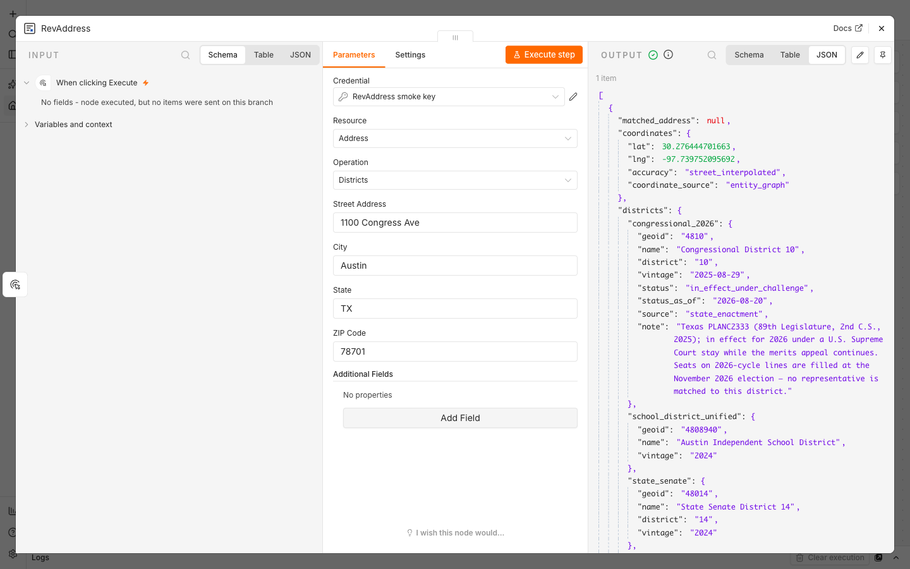

# n8n-nodes-revaddress

An [n8n](https://n8n.io/) community node for [RevAddress](https://revaddress.com/): US address standardization, congressional and state legislative districts including the 2026 redistricted line, and a federal-data profile for any US address.

**Scope, stated plainly:** address output is standardized against the U.S. Census Bureau master address file. It is not USPS-verified. There is no DPV and no CASS in this node. Use it for cleanup, matching, districts, and enrichment, not for delivery-point certainty.

[Installation](#installation)
[Operations](#operations)
[Credentials](#credentials)
[Example output](#example-output)
[Pricing](#pricing)
[Compatibility](#compatibility)
[Resources](#resources)
[Version history](#version-history)

## Installation

Self-hosted n8n: **Settings → Community Nodes → Install**, enter `n8n-nodes-revaddress`.

Manual install (Docker, npm installs, or when the UI installer is disabled):

```bash
npm install n8n-nodes-revaddress
```

Full instructions: [n8n community node installation guide](https://docs.n8n.io/integrations/community-nodes/installation-and-management/).

## Operations

One resource, **Address**, with three operations. Every operation takes the same inputs: Street Address (required), City, State, ZIP Code, and an optional Secondary Address (unit, suite, floor). Give a ZIP Code, or both City and State.

| Operation | What comes back | Credits |
|---|---|---|
| **Validate** | The standardized address (street, city, state, ZIP), coordinates, and a `resolution.classification` of `standardized_unverified`. Census-based; not USPS-verified. | 1 |
| **Districts** | Current congressional district and sitting House member, the **2026 redistricted line** (`congressional_2026`) where a state redrew, state senate and house districts, county, place, school district, and both US senators. | 3 |
| **Profile** | Nine federal datasets with provenance on every block: ACS neighborhood demographics, FEMA flood zone, elevation, Coastal Barrier Resources System, wildfire risk, Opportunity Zone status, National Risk Index hazard loss, FCC broadband, districts, and the National Register of Historic Places. | 5 |

The node is declarative: each operation is a single `GET` against `https://api.revaddress.com` and returns the API's JSON as the item's output. Every request carries `X-RevAddress-Surface: n8n`.

## Credentials

1. Get a free API key at **https://revaddress.com/signup/?label=n8n** (1,000 requests a month, no card). Keys start with `rv_live_`.
2. In n8n, create a **RevAddress API** credential and paste the key.
3. Click **Test**. The test calls `GET /api/my/usage`, which is scoped to your key, costs no credits, and returns your tier and month-to-date usage. A bad key returns 401.

The key is sent as the `X-API-Key` header. API reference: https://revaddress.com/docs/

## Example output

**Districts** for `1100 Congress Ave, Austin, TX 78701` (trimmed):

```json
{
  "matched_address": "1100 CONGRESS AVE, AUSTIN, TX, 78701",
  "coordinates": { "lat": 30.2764, "lng": -97.7398, "accuracy": "street_interpolated" },
  "districts": {
    "congressional": {
      "geoid": "4837", "name": "Congressional District 37", "district": "37", "vintage": "119",
      "representative": { "name": "Lloyd Doggett", "party": "D", "url": "https://doggett.house.gov" }
    },
    "congressional_2026": {
      "geoid": "4810", "name": "Congressional District 10", "district": "10",
      "vintage": "2025-08-29", "status": "in_effect_under_challenge", "source": "state_enactment"
    },
    "state_senate": { "geoid": "48014", "name": "State Senate District 14", "district": "14" },
    "state_house": { "geoid": "48049", "name": "State House District 49", "district": "49" },
    "county": { "geoid": "48453", "name": "Travis County" },
    "place": { "geoid": "4805000", "name": "Austin city" },
    "school_district_unified": { "geoid": "4808940", "name": "Austin Independent School District" }
  },
  "senators": [
    { "name": "John Cornyn", "party": "R" },
    { "name": "Ted Cruz", "party": "R" }
  ],
  "source": "census_geocoder"
}
```

`congressional_2026` is present only where a state enacted a new map for the 2026 cycle. Its `status` and `note` fields carry the litigation state of that map as of the response date.



## Pricing

A free key includes 1,000 requests a month, plus 1,000 credits on signup good for 30 days. Credit costs per operation are in the table above. Paid tiers and credit packs: https://revaddress.com/pricing/

## No USPS DPV in this node

Validate standardizes against the Census Bureau master address file and reports `classification: standardized_unverified`. It does not confirm that USPS delivers to the address. If you need delivery-point validation, that is a different product and a different claim; this node does not make it.

## Compatibility

Built with `@n8n/node-cli` against `n8n-workflow` 2.x. Requires Node.js 22 or later for local development. The node declares `usableAsTool: true`, so it can be attached to an AI Agent node as a tool.

## Resources

* [RevAddress API docs](https://revaddress.com/docs/)
* [RevAddress signup (free key)](https://revaddress.com/signup/?label=n8n)
* [n8n community nodes documentation](https://docs.n8n.io/integrations/community-nodes/)
* [Source and issues](https://github.com/jtalk22/n8n-nodes-revaddress)

## Version history

* **0.1.0** — Initial release. Address resource with Validate, Districts, and Profile operations. RevAddress API credential with a zero-cost key test.

## License

[MIT](LICENSE.md)
